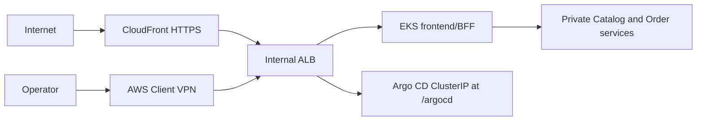

# TechX Infrastructure

Minimal Terraform foundation for the TechX internship staging environment.
Staging mutations now require the separate S3 backend, `TECHX_STATE_BUCKET`
and `TECHX_STATE_KMS_KEY_ARN`.
Bootstrap the private state bucket before planning/applying; never delete local
state to bypass migration. Offline verification uses isolated Terraform data
directories. CI/CD bootstrap and lifecycle automation are in progress; see
`../docs/CICD_AUTOMATION_DESIGN.md` for verified and pending deliverables.
Saved-plan review binds execution to the account, checksum, cost gate and destroy
deadline. An explicit deployment command runs these checks without a repeated
confirmation sentence.

## One-command maintenance

For an existing staging environment, use the normal AWS credential chain and
the existing ignored private variable file:

```powershell
./scripts/deploy-reviewed-environment.ps1 `
  -ExpectedAccountId '058114477594' -Stage maintenance `
  -BudgetAlertEmail 'owner@example.com' `
  -DestroyDeadline '<YYYY-MM-DDTHH:mm:ss+07:00>'
```

This creates and reviews a saved plan, then applies its exact checksum. The
maintenance stage permits only in-place updates to the CloudFront distribution,
Order table IAM policy and DynamoDB endpoint policy; no-op is supported. Creation,
replacement, deletion, worker scaling and unrelated resources are rejected.
The default maintenance flow preserves existing EKS API CIDRs. Cost estimation
covers at least the remaining time until the destroy deadline.

## Offline and read-only workflow

```powershell
./scripts/verify.ps1
./scripts/preflight.ps1 -Environment staging
./scripts/cost-estimate.ps1 -Hours 12
```

The checks pin Terraform/providers, validate and scan all modules, verify EKS
1.35/add-on/AZ/quota availability, simulate required IAM permissions, and keep
the conservative cost upper bound below the 60 USD apply gate. Read-only
preflight does not create AWS resources.

Create a private, ignored saved plan only when the email and same-day destroy
deadline are correct:

```powershell
Copy-Item ./environments/staging/terraform.tfvars.example ./environments/staging/domain-vpn.private.tfvars

# Plan A creates the foundation and internal ALB. Certificate ARNs stay only in
# the ignored private variable file.
./scripts/create-reviewed-plan.ps1 `
  -Environment staging `
  -Stage foundation `
  -BudgetAlertEmail 'owner@example.com' `
  -DestroyDeadline '<YYYY-MM-DDTHH:mm:ss+07:00>' `
  -MaximumHours 12
```

The script isolates the Helm repository cache, refreshes the caller `/32`,
creates `.plans/staging-foundation.tfplan`, verifies every managed resource is in scope,
checks `add/change/destroy`, writes a SHA-256 checksum, and records a reviewed
summary. The private plan and summary are ignored by Git.
After Plan A is applied and the shared internal ALB ARN is copied into the
private variable file, create Plan B with `-Stage edge`. Plan B is independently
reviewed and creates only CloudFront, private Route 53, and Client VPN resources.

If a partially created foundation cannot reach the EKS API because CGNAT
rotates across known egress ranges, create a reviewed `recovery` stage with
`-PublicAccessCidrs`. Only that stage can enable up to four temporary `/24` or
`/32` ranges. A reviewed edge migration may preserve those exact temporary
ranges until Client VPN acceptance; a later hardening plan removes them.

Do not run `terraform apply` directly from configuration. Phase 7 may apply
only the exact saved plan. Apply through the checksum/deadline guard so the
same isolated Helm repository cache is used during planning and execution:

```powershell
./scripts/apply-reviewed-plan.ps1 `
  -Environment staging `
  -Stage foundation `
  -ApprovedChecksum '<sha256-from-summary>' `
  -ApprovedDestroyDeadline '<deadline-from-summary>'
```

Any changed account, region, IP, estimate, deadline, configuration, or
checksum invalidates approval and requires a new plan. The budget in the plan
sends actual-cost alerts at 40, 60, and 72 USD; 80 USD remains the hard cap,
while alerts are not a real-time hard stop.

## Certificate and DNS prerequisites

Request the public ACM certificate for `shop.dinhminhkhoa.id.vn` in
`us-east-1`, publish its validation CNAME in Cloudflare as DNS-only, and wait
for ACM status `ISSUED`. Never store a Cloudflare token in this repository.

After explicit approval for the certificate mutation, the guarded helper
returns the exact validation record without exposing any private key:

```powershell
./scripts/prepare-domain-certificates.ps1 `
  -Environment staging `
  -Action RequestPublic `
  -ExpectedAccountId '<12-digit-account-id>'

# Run after adding the returned DNS-only CNAME in Cloudflare.
./scripts/prepare-domain-certificates.ps1 `
  -Environment staging `
  -Action Status `
  -ExpectedAccountId '<12-digit-account-id>'
```

Generate the Client VPN mutual-TLS material outside the workspace:

```powershell
./scripts/new-client-vpn-pki.ps1 -Environment staging
```

Import the generated server certificate and operator reference certificate into
ACM using their certificate, private key, and `ca.crt` chain. Put only the two
returned ACM ARNs in `domain-vpn.private.tfvars`. The generated operator
certificate/key are later embedded into the exported `.ovpn` file locally; the
entire PKI directory and completed profile are secrets and must not appear in
Git, command logs, screenshots, or report evidence.

```powershell
./scripts/prepare-domain-certificates.ps1 `
  -Environment staging `
  -Action ImportVpn `
  -ExpectedAccountId '<12-digit-account-id>'
```

After Plan B creates an available endpoint, export the completed profile outside
Git. The helper validates the AWS account and endpoint, normalizes the AWS VPN
hostname, embeds the operator credential locally, and restricts the directory
ACL without printing profile contents:

```powershell
./scripts/export-client-vpn-profile.ps1 `
  -Environment staging `
  -ClientVpnEndpointId 'cvpn-endpoint-<id>' `
  -ExpectedAccountId '<12-digit-account-id>'
```

## Environment lifecycle

The staging baseline profile can retain its foundation between tests. Suspend it by
removing the Argo CD Application and ALB before scaling the worker node to zero:

```powershell
./scripts/suspend-environment.ps1 -Environment staging -RetentionDeadline '2026-08-20T18:00:00+07:00'
```

Resume it for the next AWS-only test without Terraform apply:

```powershell
./scripts/resume-environment.ps1 -Environment staging
```

The IDLE state still keeps the EKS control plane and other foundation resources,
so it still has a cost. Retention is limited to seven days.

The domain/VPN profile deliberately rejects this baseline IDLE path: an internal
ALB and Client VPN association would continue to accrue hourly cost. After the
acceptance window, disconnect AWS VPN Client, remove the public Cloudflare
`shop` CNAME, and perform the dependency-ordered teardown:

```powershell
./scripts/domain-vpn-inventory.ps1 -Environment staging
./scripts/destroy-domain-vpn-environment.ps1 `
  -Environment staging `
  -ExpectedAccountId '<12-digit-account-id>' `
  -ConfirmDestroy
```

The teardown removes edge resources first, then workload/Ingress resources,
waits for the internal ALB to disappear, destroys the foundation, and fails if
the final TechX inventory (including ECR repositories) is not empty. Each phase
applies a saved plan reviewed to permit only deletion/no-op; edge deletion is
restricted to the edge modules. It preserves the live EKS API CIDRs and uses an
isolated kubeconfig with an explicit account/cluster context. Private keys, VPN profiles, private
Terraform variables, saved plans, and approval summaries remain Git-ignored.

## Deliberate security exceptions

- EKS 1.35 uses the default AWS-owned KMS v2 envelope encryption available to
  EKS 1.28+, avoiding a needless customer-key charge.
- The EKS public API is normally enabled only for one validated caller IPv4
  `/32`; its private endpoint is also enabled. A reviewed recovery plan may
  temporarily use up to four reviewed ranges for rotating CGNAT and must return to `/32` or
  private-only access after VPN acceptance.
- Two public subnets and one public node IPv4 are intentional in this no-NAT
  staging environment so the node can reach EKS add-ons/ECR. Two private subnets host only the
  internal ALB and one Client VPN association. No node security group opens
  direct Internet ingress.
- VPC CNI NetworkPolicy enforcement is explicitly enabled. Only the temporary
  baseline profile uses an internet-facing ALB; the domain/VPN profile uses one
  internal ALB reached by CloudFront or the VPN association security group.

## Shared deployment contract

This table is the handoff contract copied verbatim across `techx-platform`,
`techx-chart`, and `techx-infra`. Contract changes must update all three
copies, every affected consumer, and the corresponding tests in one coordinated
change.

| Contract item        | Locked value                                                                                                                                                                                                                        |
| -------------------- | ----------------------------------------------------------------------------------------------------------------------------------------------------------------------------------------------------------------------------------- |
| AWS region           | `us-east-1`                                                                                                                                                                                                                         |
| Kubernetes namespace | `techx-staging`                                                                                                                                                                                                                     |
| Services / ports     | `frontend:3000`, `catalog-api:3001`, `order-api:3002`                                                                                                                                                                               |
| Cluster DNS          | `frontend.techx-staging.svc.cluster.local:3000`, `catalog-api.techx-staging.svc.cluster.local:3001`, `order-api.techx-staging.svc.cluster.local:3002`                                                                               |
| Secret / key         | Secret `techx-staging-secrets`, data key `order-api-key`; injected as `ORDER_API_KEY` only into frontend and Order                                                                                                                  |
| Runtime environment  | Frontend: `CATALOG_API_URL`, `ORDER_API_URL`, `ORDER_API_KEY`; Catalog: `CATALOG_PORT`; Order: `ORDER_PORT`, `CATALOG_API_URL`, `ORDER_API_KEY`, `ORDER_TABLE_NAME`, `AWS_REGION`, `ORDER_STORE_TTL_MS`, `ORDER_IDEMPOTENCY_TTL_MS` |
| Health / readiness   | Every service exposes unauthenticated `GET /healthz` and `GET /readyz`                                                                                                                                                              |
| Order store          | DynamoDB single-table persistence; orders retained 30 days, idempotency records 24 hours; TTL is enforced by the application and DynamoDB cleanup                                                                                   |
| Pricing              | Catalog price snapshot; shipping `999` cents below subtotal `5000`, otherwise free; `totalCents = subtotalCents + shippingCents`                                                                                                    |
| Images               | `058114477594.dkr.ecr.us-east-1.amazonaws.com/techx/frontend:staging-{short-sha}`, `.../techx/catalog:staging-{short-sha}`, `.../techx/order:staging-{short-sha}`                                                                   |
| Exposure             | CloudFront is the only public entry point and reaches one internal ALB through a VPC origin; Catalog, Order, and Argo CD remain `ClusterIP` services                                                                                |
| Public URL           | `https://shop.dinhminhkhoa.id.vn/`; public `/argocd` and `/argocd/*` return `403`                                                                                                                                                   |
| Private operator URL | The same hostname resolves to the internal ALB over AWS Client VPN; Argo CD is available only at `https://shop.dinhminhkhoa.id.vn/argocd/`                                                                                          |
| DNS and TLS          | Cloudflare owns public DNS, Route 53 provides the private split-view record, and one issued ACM certificate covers the storefront hostname                                                                                          |
| Network boundary     | One internal ALB serves frontend and Argo CD; only CloudFront may use HTTP `80`, only the Client VPN association security group may use HTTPS `443`                                                                                 |

Infrastructure constraints stay additional to the shared handoff: EKS `1.35`,
one `t3.medium` AL2023 x86_64 node, forecast at or below 60 USD, hard cap 80
USD, staging VPC `10.52.0.0/16`, Client VPN `172.24.0.0/22`, and explicit
user approval before the first AWS mutation.



No AWS resource exists merely because this repository exists. `terraform apply`
is forbidden until the reviewed-plan approval checkpoint.

Licensed under Apache-2.0. See [LICENSE](LICENSE).

## Automation App credential admission

Automation remains disabled until the control plane and a new deployment window
have been approved. Opening preview schema v3 binds separate Promotion and
Lifecycle App identities. Both preview and start recheck the real App,
installation, maximum permissions and actual repository scope. Preflight issues
only repository-specific read tokens and revokes them; it does not issue merge
or workflow-dispatch tokens.

The protected main environments `staging-chart-read` and `staging-start` need
`PROMOTION_APP_PRIVATE_KEY` and `LIFECYCLE_APP_PRIVATE_KEY`. Public variables are
`PROMOTION_APP_ID`, `PROMOTION_APP_SLUG`, `PROMOTION_INSTALLATION_ID`,
`LIFECYCLE_APP_ID`, `LIFECYCLE_APP_SLUG` and `LIFECYCLE_INSTALLATION_ID`, taken
from the actual installations. Promotion maximum permissions are Contents write
and Pull requests, Actions and Administration read on chart. Lifecycle maximum
permissions are Contents read and Actions write on infra/platform. The two Apps
must have different IDs. Missing configuration fails admission; a v2 opening
request cannot be reused as a v3 approval.

Before foundation plan or apply initializes Terraform or prepares assets, the
private worker verifies the existing Secrets Manager keys
`techx/automation/promotion-app` and `techx/automation/lifecycle-app`, including
account, region, control tags, KMS key, AWSCURRENT version, signed App identity,
installation and actual read-token scope. It compares these with the reviewed
opening proof and records only public identities and exact ARN/VersionId
references in the private session snapshot using conditional S3 writes. It
rechecks key versions after API verification and immediately before foundation
apply. Private chart promotion also requires the same pinned versions. Rotation
or changed authority stops the operation; an existing session pin is never
replaced. No control key is created or rotated by this check, and private keys,
JWTs and tokens do not enter the proof or Terraform inputs.

These checks have offline regression coverage. Real App setup, private control
secrets, branch enforcement, IAM/network and end-to-end acceptance remain live
prerequisites; offline success does not authorize AWS deployment.

After the reviewed edge apply, the typed private task `activate / exposure / 1`
pins the committed edge/GitOps predecessors, state lineage/serial and resource
IDs. It observes the actual CloudFront distribution/VPC origin and the single
mutual-TLS Client VPN association before creating the DNS-only `shop` CNAME.
It checks both public recursive resolvers and every discovered authoritative
Cloudflare nameserver. Session ownership and a durable DNS intent precede the
create request; a lost response is reconciled against the exact owned record,
never by blindly repeating POST. Cleanup persists positive creation evidence
before DELETE so a lost delete response can be recovered. An empty read after
an unknown create cannot authorize teardown completion.

The versioned private activation receipt is verified before the lifecycle
reports `ACCEPTANCE`. `ACTIVATED` leaves the session `PROVISIONING`: public
HTTPS/API checks, authenticated management checks, runtime digest verification
and a real VPN client test still require the acceptance worker. Activation
alone never marks the session `READY`. This path has offline tests; it has not
been accepted on AWS/Cloudflare and both automation flags remain disabled.

Public acceptance now has its own protected `staging-acceptance.yml` handoff
and IAM role. The exact admitted first-attempt main run must be observed on a
GitHub-hosted Ubuntu job; the worker holds the deploy lease and rechecks the
activation/selection/release, budget, schedule and ownership before requests.
Public connections use validated global IPs with verified TLS/SNI, no proxy or
redirect following. The suite checks DNS, storefront, HTTP-to-HTTPS redirect,
public Argo blocking, health/readiness, catalog/detail/config, order creation,
idempotent replay/conflict/lookup, no-store/request-ID behavior and an observed
immutable static-asset cache hit. Failures preserve bounded private diagnostics.

The role cannot deploy, access control secrets or read private inputs. It alone
can produce versioned public evidence; the parent verifies the exact private
receipt and dispatched run before consuming it. Cleanup fences this HTTP-only
probe without requiring GitHub cancellation after stopping infrastructure
executors. Public success leaves PROVISIONING and dispatches the single-use
`verify/private/1` task on the fixed executor. Its OpenVPN client must prove an
AWS connection ID/client address, the matching TUN route, private DNS and
verified HTTPS before authenticated Argo and runtime/resilience checks. The
worker verifies exact chart/image digests, DynamoDB/IRSA, automatic replica
self-heal and order/idempotency persistence after an observed Pod replacement.
It must positively observe VPN disconnect before writing its private receipt.

Only the terminal successful child plus verified activation/public/private
receipts allow the parent to publish `READY`, `acceptedRelease` and lease release
in one CAS. The manager still requires terminal SSM success; continuation also
requires terminal CodeBuild success and the same evidence. A `deploy-test-destroy`
session requests independent cleanup after acceptance; `deploy-window` keeps the
original verified deadline. These paths have offline tests and remain disabled
pending live acceptance. Active-session rollout and public checks are described
below; bounded Git rollback still requires implementation.

READY-session publication now has immutable candidate/manifest/proposal receipts.
The protected platform main workflow checks its actual completed acceptance job
and active publisher job before the helper obtains the release lease. The helper
verifies the accepted cold baseline, source ancestry, scoped identity, original
budget/window/schedule and exact scanned ECR artifacts. It writes a session-bound
intent before publishing, then proposes only the two allowed chart release files.
It never merges or changes the running Application/accepted baseline. Active
chart notifications bind only a fully proposed candidate with matching immutable
receipts and actual PR/run identity; the dispatcher receives version-read only.
Candidate review/promotion and rollout are described below. Repeated-release
rollback still requires implementation; both flags remain
disabled pending those paths and live tests.

Bootstrap verification:

The protected promotion review workflow can also preview a READY candidate and
issue a separate `ready-promotion-approval` after real human review. It verifies
the accepted baseline, completed source CI, exact chart tree/head/CI, reviews
and the opening App/main policy. Active grants cannot be consumed as cold grants;
they retain original execution revisions and do not authorize a runner to merge.
The orchestrator can dispatch and consume this active review under a separate
protected handoff. It rechecks terminal CodeBuild/SSM and the same accepted
receipts, binds the actual review run and grant index, and stores the grant only
on the unchanged candidate by CAS. Pending source/PR CI and publisher leases
remain bounded waits; a publisher cannot republish a candidate under review.
The `release/active` private task now performs the exact approved App merge,
waits for the same merged SHA's successful main CI, then pins the existing Argo
Application to that revision. Its JSON Patch checks UID, accepted spec/session
and writes a unique intent stamp; lost responses reconcile positive observations
without replay. The task verifies Synced/Healthy and all three running image
digests. Its private rollout receipt is reread by the parent. The session remains
TESTING and the accepted baseline stays unchanged until active public/private
acceptance. The protected hosted public handoff now runs the complete public
suite against the exact versioned rollout and candidate. It keeps separate active
receipts, checks the actual hosted job and original infra SHA, and the parent
consumes only that dispatched run's evidence, then dispatches `verify/active/1`
while TESTING with the previous baseline. The private executor checks VPN,
authenticated Argo, exact runtime digests, DynamoDB/IRSA, self-heal and the new
public order/idempotency after another Order Pod replacement. It must disconnect
the VPN before persisting its private versioned receipt.

After that child exits successfully, its parent rereads the rollout/public/private
proofs and writes immutable accepted history. READY, the new accepted baseline,
the current history snapshot, candidate removal and lease release share one CAS.
Dispatcher continuation additionally observes the exact SSM and CodeBuild terminal
success. Baseline consumers read the versioned history chain down to cold evidence;
the original execution revisions/checkpoints remain unchanged. History is bounded
to 64 active releases per session. Cleanup fencing and child failure cannot publish
READY. Bounded Git rollback remains unfinished. This is source/offline progress,
not cloud acceptance; the changed task loader requires a new
reviewed AMI build before cloud use.

```powershell
./scripts/verify.ps1
```
